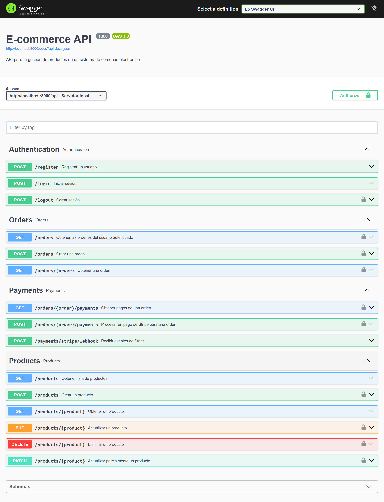
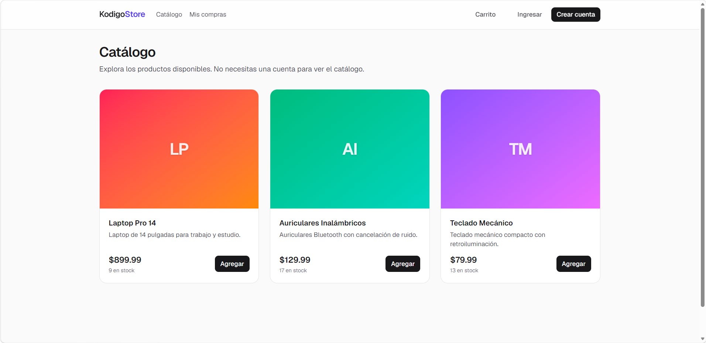
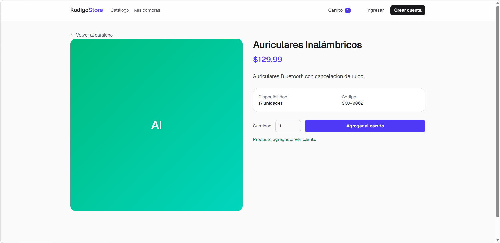
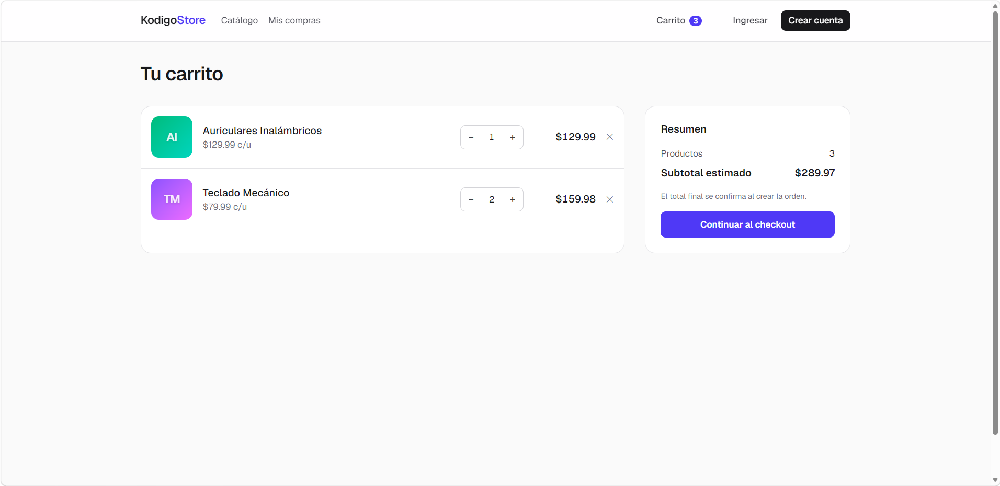
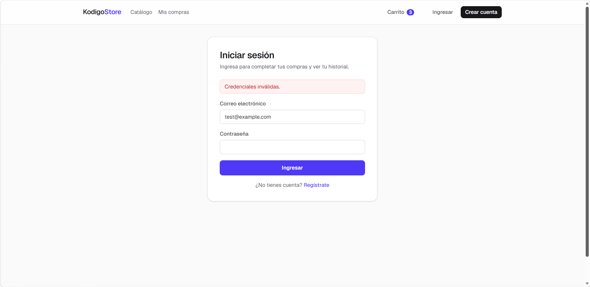
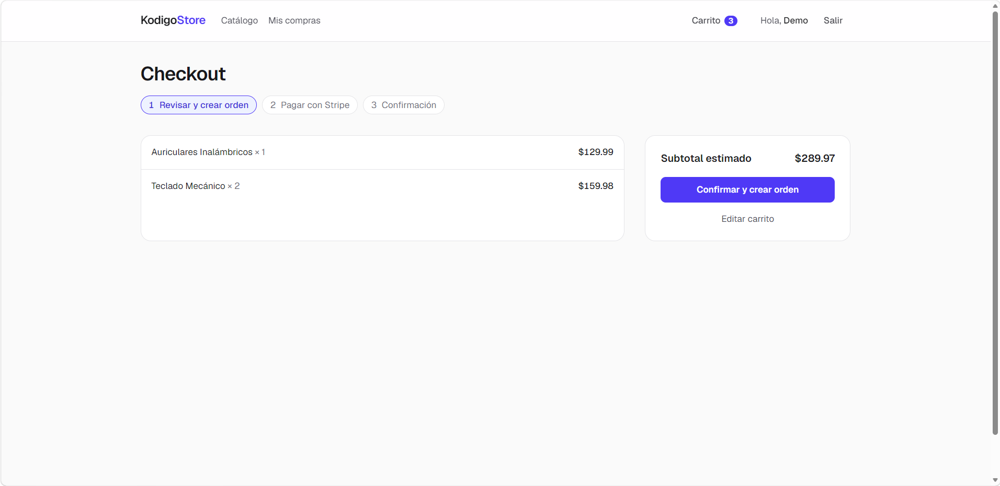
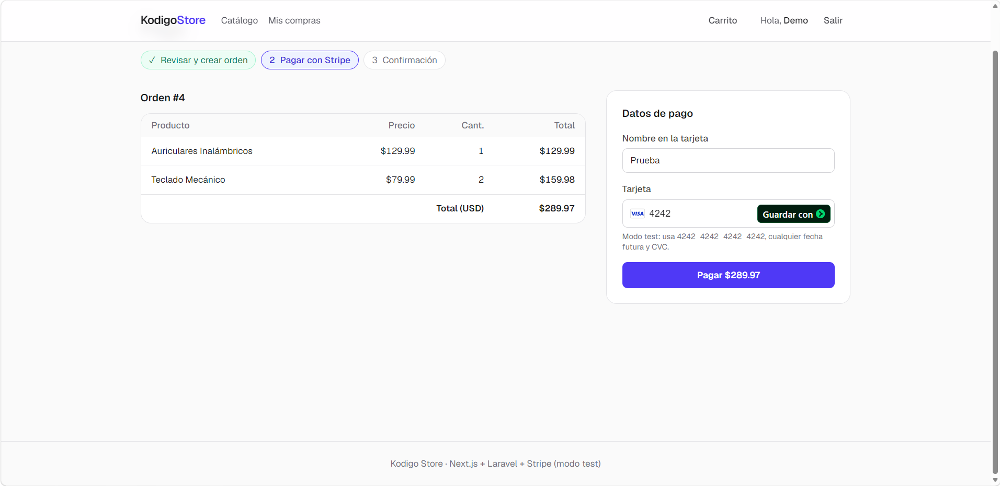
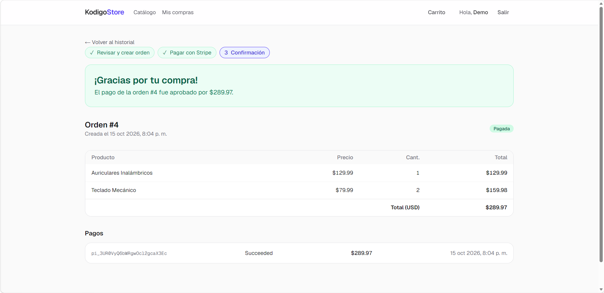
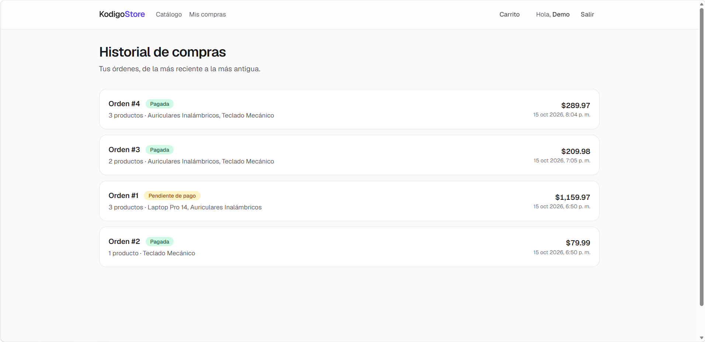
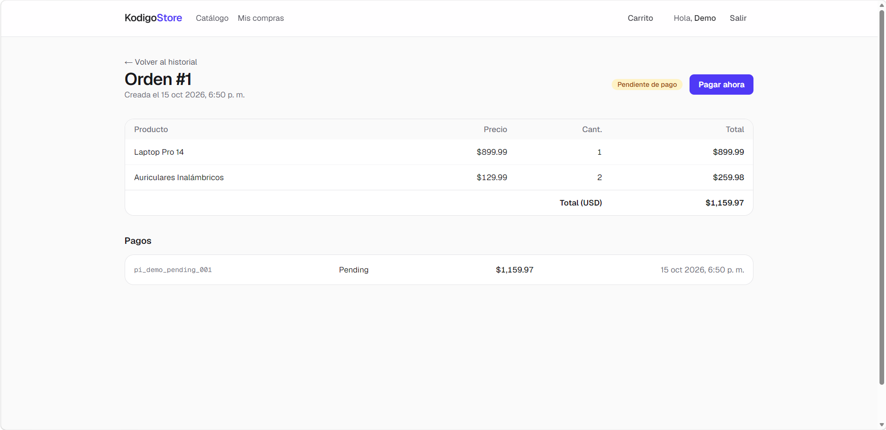

# Kodigo Store — Frontend E-commerce en Next.js

Aplicación web en **Next.js 16 (App Router) + TypeScript + Tailwind CSS** que consume la API REST de e-commerce construida en **Laravel** ([ecomerce-api](https://github.com/BrandonC2003/ecomerce-api)), con autenticación JWT y pagos con **Stripe**.

Implementa el flujo completo de compra: catálogo → carrito → orden → pago → confirmación → historial.

## Stack y enfoque

| Necesidad | Cómo se resolvió |
| --- | --- |
| Lecturas | **Server Components** con `fetch` en el servidor (`src/lib/data.ts`). El catálogo se cachea con `"use cache"` + `cacheTag("products")`. |
| Mutaciones | **Server Actions** (`src/app/actions/`): registro, login, logout, crear orden y pagar. |
| Token seguro | El JWT se guarda en una **cookie `httpOnly`** (`sameSite=lax`, `secure` en producción) desde el servidor (`src/lib/session.ts`). El navegador nunca lo ve. |
| Rutas protegidas | **`src/proxy.ts`** (el antiguo `middleware` en Next 16) redirige a `/login?next=…` si no hay sesión. Un **Route Handler** (`/auth/expired`) limpia la cookie cuando la API responde 401. |
| Carrito | Estado local en el cliente (`useSyncExternalStore`) persistido en `localStorage`. |
| Pago | **Stripe.js** (`CardElement`) crea el `PaymentMethod`; el Server Action lo envía a `POST /orders/{id}/payments`. Soporta 3D Secure con `stripe.handleNextAction`. |
| UI actualizada tras mutaciones | `updateTag("products")` al crear una orden (el stock baja de inmediato) y `revalidatePath("/orders")` / `revalidatePath("/orders/{id}")` al crear y pagar. |
| Carga y errores | `loading.tsx` y `error.tsx` en catálogo, checkout e historial; `<Suspense>` en la lista de productos y en el historial. |
| Web Vitals | `useReportWebVitals` (`src/components/web-vitals.tsx`) registra LCP, CLS, INP, FCP y TTFB en la consola. |

> El proyecto usa **Cache Components** (opción por defecto en Next 16): las partes estáticas se prerenderizan y los datos de la API o de la sesión se transmiten en streaming detrás de `<Suspense>`.

## Requisitos

- Node.js 20.9 o superior y npm.
- La API de Laravel en ejecución (por defecto en `http://127.0.0.1:8000`).
- Clave publicable de Stripe en **modo test** (`pk_test_…`).

## Configuración (`.env.example`)

```bash
cp .env.example .env.local
```

```dotenv
# URL base de la API de Laravel.
API_BASE_URL=http://127.0.0.1:8000/api

# Clave publicable de Stripe. Debe ser de la misma cuenta que STRIPE_SECRET_KEY de la API.
NEXT_PUBLIC_STRIPE_PUBLISHABLE_KEY=pk_test_xxxxxxxxxxxxxxxxxxxxxxxx
```

## Ejecutar el proyecto

```bash
npm install
npm run dev                  # http://localhost:3000

# Build de producción (la usada para Lighthouse)
npm run build
npm start
```

## Rutas implementadas

| Ruta | Acceso | Descripción | Endpoint(s) de la API |
| --- | --- | --- | --- |
| `/` | Pública | Redirige a `/products`. | — |
| `/products` | Pública | Catálogo paginado (`?page=`). | `GET /products` |
| `/products/[id]` | Pública | Detalle del producto y botón para agregar al carrito. | `GET /products/{id}` |
| `/register` | Solo invitados | Registro; inicia sesión al terminar. | `POST /register` |
| `/login` | Solo invitados | Inicio de sesión; respeta `?next=`. | `POST /login` |
| Botón **Salir** | Autenticado | Cierra sesión e invalida el JWT. | `POST /logout` |
| `/cart` | Pública | Carrito local: agregar, quitar y cambiar cantidades. | — |
| `/checkout` | Protegida | Revisa el carrito y crea la orden. | `POST /orders` |
| `/checkout/[orderId]` | Protegida | Pago con Stripe de una orden pendiente. | `GET /orders/{id}`, `POST /orders/{id}/payments` |
| `/orders` | Protegida | Historial de compras paginado. | `GET /orders` |
| `/orders/[id]` | Protegida | Detalle de la orden, sus pagos y la confirmación de compra (`?status=success`). | `GET /orders/{id}` |
| `/auth/expired` | Route Handler | Elimina la cookie de sesión vencida y redirige a `/login`. | — |

## Estructura

```
src/
├── proxy.ts                 # Protección de rutas (antes middleware.ts)
├── app/
│   ├── actions/             # Server Actions: auth.ts, orders.ts
│   ├── auth/expired/        # Route Handler para sesiones vencidas
│   ├── products/            # Catálogo + loading.tsx + error.tsx
│   ├── cart/
│   ├── checkout/            # Crear orden y pagar + loading.tsx + error.tsx
│   ├── orders/              # Historial + loading.tsx + error.tsx
│   ├── login/ register/
│   └── layout.tsx
├── components/              # UI (formularios, carrito, pago, skeletons…)
└── lib/
    ├── api.ts               # Cliente HTTP de la API (solo servidor)
    ├── data.ts              # Lecturas (cacheadas y privadas)
    ├── session.ts           # Cookies httpOnly
    └── cart-store.ts        # Estado del carrito
```

## Evidencias

### Endpoints consumidos (Swagger)

Documentación de la API en `/api/documentation`. El frontend consume los endpoints de autenticación (`/register`, `/login`, `/logout`), catálogo (`GET /products`, `GET /products/{product}`), órdenes (`GET /orders`, `POST /orders`, `GET /orders/{order}`) y pagos (`POST /orders/{order}/payments`). Los endpoints de administración de productos y el webhook de Stripe no se usan desde el frontend.



### Rendimiento (Lighthouse)

Build de producción (`npm run build && npm start`), Lighthouse 12. Reportes completos en [`docs/lighthouse/`](docs/lighthouse) (abre los `.html` en el navegador).

| Página | Perfil | Performance | Accessibility | Best Practices | SEO | LCP | CLS | TBT |
| --- | --- | --- | --- | --- | --- | --- | --- | --- |
| `/products` | Móvil | 98 | 100 | 100 | 100 | 2.3 s | 0 | 60 ms |
| `/products` | Escritorio | 100 | 100 | 100 | 100 | 0.5 s | 0 | 0 ms |
| `/products/1` | Móvil | 95 | 100 | 100 | 90 | 2.8 s | 0 | 110 ms |
| `/products/1` | Escritorio | 100 | 100 | 100 | 90 | 0.7 s | 0 | 0 ms |

En el detalle de producto, el SEO marca 90 porque, con Partial Prerendering, el título y la descripción dependen del producto y se transmiten después del `<head>`. Next.js entrega los metadatos de forma bloqueante cuando detecta un rastreador (bot), así que la indexación no se ve afectada.

Optimizaciones aplicadas: prerenderizado parcial con streaming, catálogo cacheado, ilustraciones de producto en CSS (sin peticiones de imágenes), Stripe.js cargado solo en la página de pago y fuentes con `next/font`.

### Flujo de compra

Capturas en [`docs/screenshots/`](docs/screenshots).

#### 1. Catálogo público

Listado de productos sin necesidad de iniciar sesión (`GET /products`).



#### 2. Detalle de producto

Detalle del producto y botón para agregarlo al carrito (`GET /products/{id}`).



#### 3. Carrito

Carrito en estado local: agregar, quitar y cambiar cantidades.



#### 4. Inicio de sesión

Al continuar al checkout sin sesión, el proxy redirige al login. Con credenciales incorrectas se muestra el error devuelto por la API (`POST /login`).



#### 5. Checkout

Revisión del carrito antes de crear la orden (`POST /orders`).



#### 6. Pago con Stripe

Orden creada y formulario de pago con Stripe Elements (tarjeta de prueba `4242 4242 4242 4242`).



#### 7. Confirmación de compra

Pago aprobado (`POST /orders/{id}/payments`): la orden queda como **Pagada** y se registra el PaymentIntent de Stripe.



#### 8. Historial de compras

Vista protegida con las órdenes del usuario (`GET /orders`), actualizada tras el pago con `revalidatePath`.



#### 9. Detalle de una orden pendiente

Una orden sin pagar muestra el botón **Pagar ahora** para retomar el pago (`GET /orders/{id}`).


